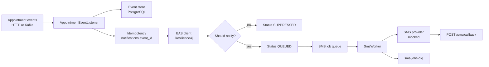

# ThunderYard Notification Service

Spring Boot service that receives appointment events, looks up current appointment data from a mocked Enterprise Appointment Service (EAS), decides whether the patient should be notified, queues an SMS job, and records the outcome.

This repo is a design-and-demo implementation of a notification pipeline that can run as multiple consumers, survive downstream outages, and avoid duplicate sends.

## What it does

1. Ingest an appointment event (HTTP today; Kafka listener is also wired).
2. Persist the raw event for audit and replay.
3. Deduplicate on stable `eventId`.
4. Call EAS for appointment details (timeout, retry, circuit breaker, fallback).
5. Suppress or queue a notification.
6. Hand off SMS work asynchronously (queue boundary).
7. Send via a mocked SMS provider, retry transient failures, and dead-letter exhausted jobs.
8. Accept delivery-status callbacks and update notification state.



## Tech stack

| Area | Choice |
|------|--------|
| Runtime | Java 21, Spring Boot 4.1.1 |
| HTTP | Spring MVC, Jakarta Validation |
| Persistence | Spring Data JPA, PostgreSQL (`ddl-auto: update`) |
| Messaging | Spring for Apache Kafka |
| Downstream HTTP | WebClient + Resilience4j (retry, time limiter, circuit breaker) |
| Security | Spring Security HTTP Basic |
| Observability | Actuator, Micrometer Prometheus registry |
| Build | Maven Wrapper (`mvnw` / `mvnw.cmd`) |

## Prerequisites

- JDK 21
- PostgreSQL on `localhost:5432`
- Docker Desktop (or another Compose runtime) for local Kafka
- Optional: a mock EAS on `http://localhost:8081` (the client falls back if it is down)

## Docker: local Kafka

SMS is **not** sent on the HTTP request thread. After a `CREATED`/`UPDATED` appointment-change, the listener saves a `QUEUED` notification and publishes an `SmsJob` to Kafka topic `sms-jobs`. `SmsWorker` consumes that topic, talks to the mocked SMS provider, and updates status (`SENT`, retry, or DLQ).

Without a broker on `localhost:9092` that path fails: the producer waits for topic metadata (`Topic sms-jobs not present in metadata`) and the request returns **500**. Duplicate `eventId`s can still return **200** because the notification row was saved *before* the Kafka send.

Docker Compose is the supported way to run Kafka for this demo. You do not need a full Kafka install. `docker-compose.yml` starts a single KRaft broker (Apache Kafka 3.9) advertised at `localhost:9092`, then `kafka-init` creates:

| Topic | Why |
|-------|-----|
| `sms-jobs` | Queue boundary for send + retries |
| `sms-jobs-dlq` | Jobs that exhausted retries |
| `appointment-events` | Optional event-bus ingest (HTTP is the usual demo path) |

```bash
# from the project root
docker compose up -d
docker compose ps
# Cygwin / Git Bash: confirm the host port
netstat -an | grep 9092
```

Wait until Kafka is healthy and `kafka-init` has listed the three topics. **Then** start (or restart) the Spring Boot app so consumers connect to a live broker. If you start the app first, Spring may not see the topics until you restart it.

```bash
docker compose down      # stop
docker compose down -v   # stop and drop Kafka volumes
```

Postgres is not in Compose; it still runs on the host as below.

## Database

Create the database and role (local demo only):

```sql
CREATE DATABASE thunderyard;
CREATE USER thunderyard_user WITH PASSWORD 'thunderyard_user';
GRANT ALL PRIVILEGES ON DATABASE thunderyard TO thunderyard_user;
```

On PostgreSQL 15+, also grant schema rights on `thunderyard` (often `\c thunderyard` then `GRANT ALL ON SCHEMA public TO thunderyard_user;`).

JDBC settings live in `src/main/resources/application.yml`. The active profile is `local`; the datasource password is overridden in `application-local.yml`.

Hibernate creates and updates tables. The important ones:

- `events` — immutable ingest log used for replay
- `notifications` — one row per `eventId` with status and failure reason

## Run

Start Kafka first (`docker compose up -d`), then:

```bash
./mvnw test
./mvnw spring-boot:run
```

On Windows CMD: `mvnw.cmd test` and `mvnw.cmd spring-boot:run`.

The API listens on `http://localhost:8080`.

Default HTTP Basic user (from `application.yml`): `demo` / `demo`.

`SecurityConfig` permits GET `/events/**`, POST `/events/replay/**`, and POST `/events/appointment-**`. If a matcher does not apply (you will see `401` and `WWW-Authenticate: Basic`), send credentials:

```bash
curl -u demo:demo ...
```

## Event flow in code

| Step | Class | Behavior |
|------|--------|----------|
| HTTP ingest | `AppointmentEventController` | `POST /events/appointment-*` → listener |
| Kafka ingest | `AppointmentEventListener` | `@KafkaListener` on `appointment-events` |
| Persist | `EventStore` | JSON payload on `events` |
| Dedupe | `NotificationRepository.findByEventId` | Duplicate `AppointmentChangedEvent` is dropped |
| EAS | `EasClient` | GET `http://localhost:8081/appointments/{id}` |
| Decide | `shouldNotify` | `CREATED` / `UPDATED` notify; `CANCELLED` suppressed |
| Queue SMS | `SmsQueueProducer` | Publishes `SmsJob` to `sms-jobs` (keyed by `appointmentId`) |
| Send | `SmsWorker` | Listens on `sms-jobs`; retries then DLQ |
| DLQ | `DlqWorker` | Listens on `sms-jobs-dlq` |
| Callback | `DeliveryCallbackController` | `POST /sms/callback` |

Notification statuses: `QUEUED`, `SENT`, `DELIVERED`, `FAILED`, `RETRIED`, `DUPLICATE`, `SUPPRESSED`.

## HTTP API

### Appointment events

| Method | Path | Body type |
|--------|------|-----------|
| POST | `/events/appointment-changed` | `AppointmentChangedEvent` |
| POST | `/events/appointment-created` | `AppointmentCreatedEvent` |
| POST | `/events/appointment-cancelled` | `AppointmentCancelledEvent` |
| POST | `/events/appointment-reminder` | `AppointmentReminderEvent` |
| POST | `/events/appointment-status-changed` | `AppointmentStatusChangedEvent` |
| POST | `/events/appointment-confirmation` | `AppointmentConfirmationEvent` |

`AppointmentChangedEvent` (full notify path) requires `eventId`, `appointmentId`, `patientId`, and `eventType` (`CREATED`, `UPDATED`, or `CANCELLED`).

```bash
curl -u demo:demo -X POST http://localhost:8080/events/appointment-changed \
  -H "Content-Type: application/json" \
  -d '{
    "eventId": "aaaaaaaa-aaaa-aaaa-aaaa-aaaaaaaaaaaa",
    "appointmentId": "bbbbbbbb-bbbb-bbbb-bbbb-bbbbbbbbbbbb",
    "patientId": "cccccccc-cccc-cccc-cccc-cccccccccccc",
    "eventType": "UPDATED",
    "timestamp": "2026-10-21T17:00:00Z",
    "source": "curl-test"
  }'
```

Ready-made scripts in `src/test/curl/`:

- `runAll1Http.sh` — ingest, validation, list, replay (200, or 500 if more than 50 events); Kafka not required
- `runAll2Kafka.sh` — SMS queue path (CREATED / duplicate / UPDATED / CANCELLED); needs Kafka
- `runAll3Eas.sh` — EAS opt-in vs reserved opt-out `appointmentId`
- `runAll4Sms.sh` — SMS success vs retryable timeout vs permanent failure (needs Kafka)
- `runAll5Metrics.sh` — scrape `/actuator/prometheus` for notification counters
- `runAll6Tracing.sh` — `X-Correlation-Id` echo + persist (`GET /events?correlationId=`)

### Event log and replay

| Method | Path | Notes |
|--------|------|--------|
| GET | `/events` | All stored events |
| GET | `/events/count` | Row count (`?type=` optional) |
| GET | `/events?type=AppointmentChangedEvent` | Filter by type |
| GET | `/events?from=2026-10-21T00:00:00Z&to=2026-10-22T00:00:00Z` | Filter by `createdAt` |
| GET | `/events?correlationId=corr-...` | Filter by correlation id |
| POST | `/events/replay/all` | Re-dispatch every stored event |
| POST | `/events/replay/{type}` | Re-dispatch one type, e.g. `AppointmentChangedEvent` |

Replay deserializes stored JSON and calls the listener again. It **aborts if the batch is larger than 50** (`IllegalStateException` → HTTP 500 today). Use type-scoped replay or trim the `events` table if you hit that guard (for example after `replaySafetyTest.sh`, which inserts 51 rows).

```bash
curl -u demo:demo http://localhost:8080/events
curl -u demo:demo -X POST http://localhost:8080/events/replay/AppointmentChangedEvent
curl -u demo:demo -X POST http://localhost:8080/events/replay/all
```

### SMS delivery callback

```bash
curl -u demo:demo -X POST http://localhost:8080/sms/callback \
  -H "Content-Type: application/json" \
  -d '{
    "notificationId": "<uuid from notifications>",
    "correlationId": "corr-<eventId>",
    "status": "DELIVERED",
    "providerCode": "OK"
  }'
```

`status` values handled: `DELIVERED`, `FAILED`, `UNDELIVERABLE`.

## Kafka topics

| Topic | Role |
|-------|------|
| `appointment-events` | Incoming appointment bus (`AppointmentChangedEvent`) |
| `sms-jobs` | SMS work + retries (max 3) |
| `sms-jobs-dlq` | Jobs that exhausted retries |

Consumer group: `notification-service`. Multiple pods can share the group; idempotency on `eventId` is what makes concurrent consumption safe.

## Resilience and safety (demo mapping)

| Concern | Current approach |
|---------|------------------|
| Queue vs sync SMS | Listener queues work; `SmsWorker` sends asynchronously |
| Stable IDs / idempotency | Unique `notifications.event_id` |
| EAS timeouts / retries / CB | `@TimeLimiter`, `@Retry`, `@CircuitBreaker` on `EasClient`; 2s WebClient timeout; fallback `canNotify=false` |
| Retryable vs permanent SMS | `RetryableSmsException` → Resilience4j retry/CB then Kafka requeue/DLQ; provider `false` → `FAILED` (no requeue) |
| Dead letter / replay | `sms-jobs-dlq`; event store + `/events/replay/**` with a 50-event cap |
| Multi-pod | Kafka consumer group + unique event IDs |
| Delivery callbacks | `QUEUED → SENT → DELIVERED` (or `FAILED`) |
| Opt-in | `AppointmentDetails.canNotify` from EAS; cancel events suppressed |
| Minimal PHI | Mock phone/message; avoid logging full payloads in production |
| Auth | HTTP Basic for the demo; production would use TLS, JWT, workload identity |
| Health | Actuator `health`, `metrics`, `prometheus` at `/actuator/**` |
| Metrics | `notifications_queued/sent/delivered/failed/retried/duplicated/suppressed_total` |
| Tracing | `X-Correlation-Id` (or generated UUID) in MDC, event row, SMS job, and logs |

## Tests

Unit and slice tests live under `src/test/java`:

- `AppointmentEventListenerTest`
- `EventStoreTest`, `EventControllerTest`, `EventPersistenceIntegrationTest`
- `EasClientTest`
- `SmsWorkerTest`, `DlqWorkerTest`, `DeliveryCallbackControllerTest`
- `CorrelationIdsTest`, `CorrelationFilterTest`

HTTP demos: `src/test/curl/*.sh`.

## Known gaps / next

- Typed appointment events other than `AppointmentChangedEvent` persist but do not run the full notify pipeline.
- Replay over 50 events returns 500 instead of a structured 4xx.
- No Zipkin/OTel exporter yet; correlation is MDC + header + stored `correlationId` (`IllegalArgumentException` is mapped to 400).
- Production auth (JWT/mTLS), secrets, and EKS probes are design topics, not fully implemented here.
