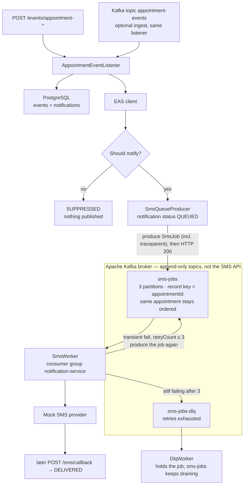

# ThunderYard Notification Service

Spring Boot service that receives appointment events, looks up current appointment data from a mocked Enterprise Appointment Service (EAS), decides whether the patient should be notified, queues an SMS job, and records the outcome.

This repo is a design-and-demo implementation of a notification pipeline that can run as multiple consumers, survive downstream outages, and avoid duplicate sends.

## What it does

1. Ingest an appointment event (HTTP today; Kafka listener is also wired).
2. Persist the raw event for audit and replay.
3. Deduplicate on stable `eventId`.
4. Call EAS for appointment details (timeout, retry, circuit breaker, fallback).
5. Suppress or queue a notification.
6. Hand off SMS work asynchronously (queue boundary).
7. Send via a mocked SMS provider, retry transient failures, and dead-letter exhausted jobs.
8. Accept delivery-status callbacks and update notification state.

Kafka sits **between “decide to notify” and “call the SMS vendor.”** The HTTP handler produces a `SmsJob` onto a durable topic and returns. A separate consumer sends, retries by re-producing, and dead-letters poison work so it does not block the main queue.



## Tech stack

| Area | Choice |
|------|--------|
| Runtime | Java 21, Spring Boot 4.1.1 |
| HTTP | Spring MVC, Jakarta Validation |
| Persistence | Spring Data JPA, PostgreSQL (`ddl-auto: update`) |
| Messaging | Spring for Apache Kafka |
| Downstream HTTP | WebClient + Resilience4j (EAS: retry, time limiter, circuit breaker; SMS mock: retry + circuit breaker) |
| Security | Spring Security HTTP Basic + OAuth2 resource server (HS256 and RS256/JWKS) |
| Observability | Actuator, Micrometer Prometheus, W3C `traceparent` in MDC (no Zipkin/OTel exporter) |
| Build | Maven Wrapper (`mvnw` / `mvnw.cmd`) |

## Prerequisites

- JDK 21
- PostgreSQL on `localhost:5432`
- Docker Desktop (or another Compose runtime) for local Kafka
- Optional: a mock EAS on `http://localhost:8081` (the client falls back if it is down)

## Docker: local Kafka

SMS is **not** sent on the HTTP request thread. After a `CREATED`/`UPDATED` appointment-change, the listener saves a `QUEUED` notification (including `traceId` from W3C `traceparent`) and publishes an `SmsJob` to Kafka topic `sms-jobs`. `SmsWorker` consumes that topic, restores the same `traceparent` into MDC, talks to the mocked SMS provider, and updates status (`SENT`, retry, or DLQ).

Without a broker on `localhost:9092` that path fails: the producer waits for topic metadata (`Topic sms-jobs not present in metadata`) and the request returns **500**. Duplicate `eventId`s can still return **200** because the notification row was saved *before* the Kafka send.

Docker Compose is the supported way to run Kafka for this demo. You do not need a full Kafka install. `docker-compose.yml` starts a single KRaft broker (Apache Kafka 3.9) advertised at `localhost:9092`, then `kafka-init` creates:

| Topic | Why |
|-------|-----|
| `sms-jobs` | Queue boundary for send + retries |
| `sms-jobs-dlq` | Jobs that exhausted retries |
| `appointment-events` | Optional event-bus ingest (HTTP is the usual demo path) |

```bash
# from the project root
docker compose up -d
docker compose ps
# Cygwin / Git Bash: confirm the host port
netstat -an | grep 9092
```

Wait until Kafka is healthy and `kafka-init` has listed the three topics. **Then** start (or restart) the Spring Boot app so consumers connect to a live broker. If you start the app first, Spring may not see the topics until you restart it.

```bash
docker compose down      # stop
docker compose down -v   # stop and drop Kafka volumes
```

Postgres is not in Compose; it still runs on the host as below.

## Database

Create the database and role (local demo only):

```sql
CREATE DATABASE thunderyard;
CREATE USER thunderyard_user WITH PASSWORD 'thunderyard_user';
GRANT ALL PRIVILEGES ON DATABASE thunderyard TO thunderyard_user;
```

On PostgreSQL 15+, also grant schema rights on `thunderyard` (often `\c thunderyard` then `GRANT ALL ON SCHEMA public TO thunderyard_user;`).

JDBC settings live in `src/main/resources/application.yml`. The active profile is `local`; the datasource password is overridden in `application-local.yml`.

Hibernate creates and updates tables. The important ones:

- `events` — immutable ingest log used for replay
- `notifications` — one row per `eventId` with status, failure reason, and `trace_id`

## Run

Start Kafka first (`docker compose up -d`), then:

```bash
./mvnw test
./mvnw spring-boot:run
```

On Windows CMD: `mvnw.cmd test` and `mvnw.cmd spring-boot:run`.

The API listens on `http://localhost:8080`.

Default HTTP Basic user (from `application.yml`): `demo` / `demo`.

`SecurityConfig` permits GET `/events/**`, POST `/events/replay/**`, and POST `/events/appointment-**`. If a matcher does not apply (you will see `401` and `WWW-Authenticate: Basic`), send credentials:

```bash
curl -u demo:demo ...
```

## Event flow in code

| Step | Class | Behavior |
|------|--------|----------|
| HTTP ingest | `AppointmentEventController` | `POST /events/appointment-*` → listener |
| Kafka ingest | `AppointmentEventListener` | `@KafkaListener` on `appointment-events` |
| Persist | `EventStore` | JSON payload on `events` |
| Dedupe | `NotificationRepository.findByEventId` | Duplicate `AppointmentChangedEvent` is dropped |
| EAS | `EasClient` | GET `http://localhost:8081/appointments/{id}` |
| Decide | `notifyIfEligible` | Created/updated/reminder/status/confirmation notify; cancel suppressed; EAS `canNotify` |
| Queue SMS | `SmsQueueProducer` | Publishes `SmsJob` to `sms-jobs` (keyed by `appointmentId`; `traceparent` copied from MDC) |
| Send | `SmsWorker` | Listens on `sms-jobs`; restores MDC from job; retries then DLQ |
| DLQ | `DlqWorker` | Listens on `sms-jobs-dlq` (same MDC restore) |
| Callback | `DeliveryCallbackController` | `POST /sms/callback` |

Notification statuses: `QUEUED`, `SENT`, `DELIVERED`, `FAILED`, `RETRIED`, `DUPLICATE`, `SUPPRESSED`.

## HTTP API

### Appointment events

| Method | Path | Body type |
|--------|------|-----------|
| POST | `/events/appointment-changed` | `AppointmentChangedEvent` |
| POST | `/events/appointment-created` | `AppointmentCreatedEvent` |
| POST | `/events/appointment-cancelled` | `AppointmentCancelledEvent` |
| POST | `/events/appointment-reminder` | `AppointmentReminderEvent` |
| POST | `/events/appointment-status-changed` | `AppointmentStatusChangedEvent` |
| POST | `/events/appointment-confirmation` | `AppointmentConfirmationEvent` |

`AppointmentChangedEvent` (full notify path) requires `eventId`, `appointmentId`, `patientId`, and `eventType` (`CREATED`, `UPDATED`, or `CANCELLED`).

```bash
curl -u demo:demo -X POST http://localhost:8080/events/appointment-changed \
  -H "Content-Type: application/json" \
  -d '{
    "eventId": "aaaaaaaa-aaaa-aaaa-aaaa-aaaaaaaaaaaa",
    "appointmentId": "bbbbbbbb-bbbb-bbbb-bbbb-bbbbbbbbbbbb",
    "patientId": "cccccccc-cccc-cccc-cccc-cccccccccccc",
    "eventType": "UPDATED",
    "timestamp": "2026-10-21T17:00:00Z",
    "source": "curl-test"
  }'
```

Curl suites in `src/test/curl/` (these are the only HTTP scripts):

- `runAll1Http.sh` — ingest every event type, validation 4xx, list (all / type / date / count), replay (200, or 413 if more than 50 events); Kafka not required
- `runAll2Kafka.sh` — SMS queue path (CREATED / duplicate / UPDATED / CANCELLED); needs Kafka
- `runAll3Eas.sh` — EAS opt-in vs reserved opt-out `appointmentId`
- `runAll4Sms.sh` — SMS success vs retryable timeout vs permanent failure, plus callback 404 (needs Kafka)
- `runAll5Metrics.sh` — `/actuator/health`, `/actuator/metrics`, Prometheus notification counters
- `runAll6Tracing.sh` — `X-Correlation-Id` echo + persist (`GET /events?correlationId=`)
- `runAll7Probes.sh` — `/actuator/health`, `/liveness`, `/readiness` (readiness wants Postgres + Kafka)
- `runAll8Typed.sh` — reminder / created / status / confirmation queue SMS; typed cancel suppressed (needs Kafka)
- `runAll9Jwt.sh` — `/sms/callback` 401 / 404 / 200 DELIVERED with HS256 JWT (needs Kafka for the 200)
- `runAll10Trace.sh` — W3C `traceparent` echoed as `traceresponse` / `X-Trace-Id` (CANCELLED, no Kafka)
- `runAll11KafkaTrace.sh` — inbound `traceparent` persisted on the notification and carried on `sms-jobs` (needs Kafka)
- `runAll12Jwks.sh` — `GET /oauth2/jwks`, `POST /oauth2/token` (Basic), RS256 Bearer on `/sms/callback`
- `runAll.sh` — runs numbered suites; one `PASS`/`FAIL` line each
- `runAllEvents.sh` / `runAllAppointmentEvents.sh` — aliases for `runAll1Http.sh` (not included in `runAll.sh`)

### Event log and replay

| Method | Path | Notes |
|--------|------|--------|
| GET | `/events` | All stored events |
| GET | `/events/count` | Row count (`?type=` optional) |
| GET | `/events?type=AppointmentChangedEvent` | Filter by type |
| GET | `/events?from=2026-10-21T00:00:00Z&to=2026-10-22T00:00:00Z` | Filter by `createdAt` |
| GET | `/events?correlationId=corr-...` | Filter by correlation id |
| POST | `/events/replay/all` | Re-dispatch every stored event |
| POST | `/events/replay/{type}` | Re-dispatch one type, e.g. `AppointmentChangedEvent` |

Replay deserializes stored JSON and calls the listener again. It **aborts if the batch is larger than 50** (`ReplayTooLargeException` → HTTP 413). `runAll1Http.sh` expects 413 when `GET /events/count` (or `?type=`) is over 50. Trim the `events` table if you need replay-all to return 200.

```bash
curl -u demo:demo http://localhost:8080/events
curl -u demo:demo -X POST http://localhost:8080/events/replay/AppointmentChangedEvent
curl -u demo:demo -X POST http://localhost:8080/events/replay/all
```

### Notification lookup

```bash
curl -u demo:demo "http://localhost:8080/notifications?eventId=<eventId>"
```

### SMS delivery callback

```bash
curl -u demo:demo -X POST http://localhost:8080/sms/callback \
  -H "Content-Type: application/json" \
  -d '{
    "notificationId": "<uuid from notifications>",
    "correlationId": "corr-<eventId>",
    "status": "DELIVERED",
    "providerCode": "OK"
  }'
```

`status` values handled: `DELIVERED`, `FAILED`, `UNDELIVERABLE`.

Callback auth is HTTP Basic **or** `Authorization: Bearer`. Mint an RS256 token (stand-in for Okta) with Basic against `/oauth2/token`; verify the public key at `GET /oauth2/jwks` (no auth).

```bash
curl -u demo:demo -X POST http://localhost:8080/oauth2/token
curl http://localhost:8080/oauth2/jwks
```

## Kafka topics

| Topic | Role |
|-------|------|
| `appointment-events` | Incoming appointment bus (`AppointmentChangedEvent`) |
| `sms-jobs` | SMS work + retries (max 3). `SmsJob.traceparent` is the HTTP W3C id so `SmsWorker` logs the same `traceId`. |
| `sms-jobs-dlq` | Jobs that exhausted retries (same `traceparent` on the payload) |

Consumer group: `notification-service`. Multiple pods can share the group; idempotency on `eventId` is what makes concurrent consumption safe.

## Resilience and safety (demo mapping)

| Concern | Current approach |
|---------|------------------|
| Queue vs sync SMS | Listener queues work; `SmsWorker` sends asynchronously |
| Stable IDs / idempotency | Unique `notifications.event_id` |
| EAS timeouts / retries / CB | `@TimeLimiter`, `@Retry`, `@CircuitBreaker` on `EasClient`; 2s WebClient timeout; fallback `canNotify=false` |
| SMS timeouts / retries / CB | `@Retry` + `@CircuitBreaker` on the mock; **no `@TimeLimiter`** (would match EAS on a real SMS WebClient) |
| Retryable vs permanent SMS | `RetryableSmsException` → Resilience4j then Kafka requeue (max 3) / DLQ; provider `false` → `FAILED` (no requeue) |
| Dead letter / replay | `sms-jobs-dlq` (`DlqWorker` holds/logs, does not auto-retry); event store + `/events/replay/**` with a 50-event cap (413) |
| Multi-pod | Consumer group `notification-service` + unique event IDs (designed for EKS; this repo runs one local process) |
| Delivery callbacks | `QUEUED → SENT → DELIVERED` (or `FAILED` / `RETRIED`) |
| Opt-in | `AppointmentDetails.canNotify` from EAS (reserved opt-out UUID); cancel events suppressed |
| Minimal PHI | Mock phone/message; worker logs use ids. **Ingest still logs the full event** (`AppointmentEventController`) — strip that in production |
| Auth | HTTP Basic; `/sms/callback` accepts HS256 or RS256 (`POST /oauth2/token` + `GET /oauth2/jwks`). No TLS, no workload identity; secrets in local YAML |
| Health | Actuator `health`, `liveness`, `readiness`; graceful Tomcat shutdown (20s) |
| Metrics | `notifications_queued/sent/delivered/failed/retried/duplicated/suppressed_total` |
| Tracing | `X-Correlation-Id` plus W3C `traceparent` on HTTP, `SmsJob`, and `notifications.trace_id`. **EAS WebClient does not forward `traceparent`.** No Zipkin/OTel exporter |

## Tests

Unit and slice tests live under `src/test/java`:

- `AppointmentEventListenerTest`, `AppointmentEventControllerTest`
- `EventStoreTest`, `EventControllerTest`, `EventReplayServiceTest`, `EventReplayControllerTest`
- `EventPersistenceIntegrationTest`
- `EasClientTest`, `GlobalExceptionHandlerTest`
- `SmsQueueProducerTest`, `SmsWorkerTest`, `DlqWorkerTest`, `SmsProviderClientTest`
- `DeliveryCallbackControllerTest`
- `NotificationMetricsTest`, `NotificationControllerTest`
- `CorrelationIdsTest`, `CorrelationFilterTest`, `TraceContextTest`
- `JwtConfigTest`, `DemoJwtKeysTest`, `OAuth2DemoControllerTest`

HTTP demos: `src/test/curl/runAll*.sh`.

## Known gaps / next

These are production swaps, not missing demo slices:

- No Zipkin/OTel exporter; ids live in MDC/headers/payload only. EAS outbound calls do not send `traceparent`.
- Auth is demo HMAC + in-process RSA/JWKS. Production: Okta (or similar) JWKS, TLS, mTLS, workload identity. HMAC remains for `runAll9Jwt`.
- SMS mock has no `@TimeLimiter`. Ingest logs the full event body (PHI). Not deployed to EKS.
- `IllegalArgumentException` → 400; `ReplayTooLargeException` → 413.
